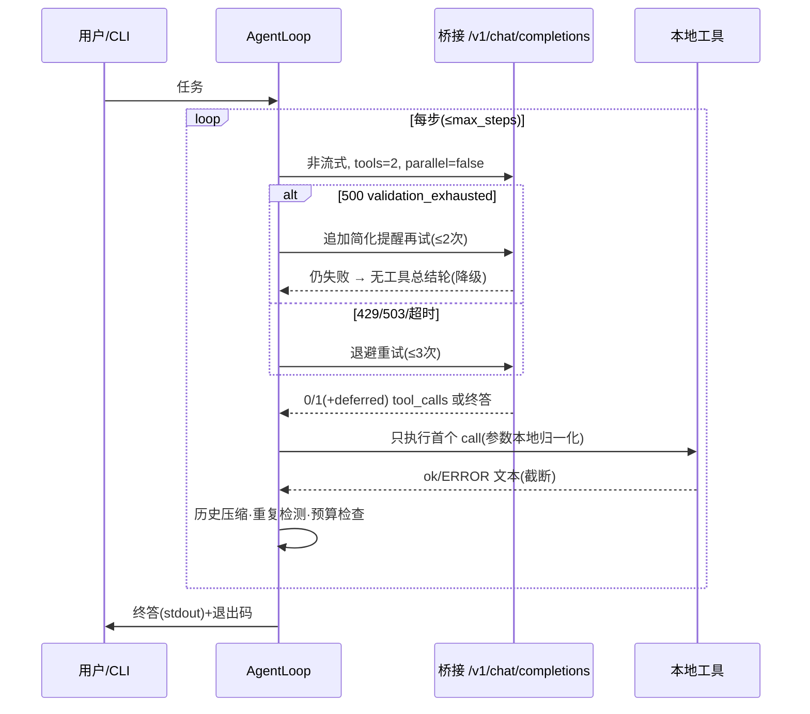

# uwa-agent：为 universal-web-api 特调的最小 CLI Agent

> 代码：`agent/`（仅标准库依赖）· 单测：`tests/test_agent_*.py` + `tests/test_dsml_tool_calls.py`（90+ 项）· 版本：0.2.0
>
> 一句话：通用 Agent（Claude Code / Cline / CrewAI…）是按“原生 API 模型”设计的，
> 遇到本项目的**网页桥接**（慢、高延迟、弱结构化输出）就会高失败；
> uwa-agent 是按桥接的脾气反向设计的最小 Agent：工具极简、单步单调、失败自愈。

## 1. 为什么通用 Agent 在本项目上高失败

对照服务端代码，失败有 5 个结构性原因（按致命程度排序）：

| # | 根因 | 服务端证据 | 通用 Agent 的踩雷行为 |
|---|------|-----------|----------------------|
| 1 | **工具膨胀**：`tools` 全量 JSON 注入系统提示，网页端模型抓不住重点 | `build_browser_messages_for_tools` 把全部 `AVAILABLE_TOOLS` 塞进 system prompt | 一次发 10~30 个工具，嵌套 schema，模型编造工具名/漏必填字段 |
| 2 | **一坏全坏**：一轮多 calls 中只要有一个参数非法，整轮 500 | `_inspect_tool_response` 校验 + `complete_tool_calling_roundtrip` 重试耗尽即抛 `tool_call_validation_exhausted` | `parallel_tool_calls=true`，多调用并行，成功率相乘式下跌 |
| 3 | **重试昂贵**：每次内部修复都是一次完整浏览器 roundtrip（数十秒） | `TOOL_CALLING_INTERNAL_RETRY_MAX=2`，每次重试重新走浏览器工作流 | 复杂 schema（anyOf/enum/嵌套对象）→ 非法 JSON → 2 次慢重试 → 超时/500 |
| 4 | **历史膨胀**：每轮把全部历史扁平重发，越跑越慢、越跑越空 | 工作流把 messages 扁平为 `role: text`，超长改文件粘贴 | 长任务堆积 tool 结果，首包超时、“回复为空” |
| 5 | **流式假设错位**：桥接的工具流是整轮缓冲后一次性下发 | `iter_tool_stream_chunks` 只发一个全量 delta + DONE | 客户端按增量解析，表现为“卡死后突然全量返回”或客户端超时 |

结论：**不要让弱结构化模型做难事**。Agent 侧能做的最大优化是
“工具做少、schema 做扁、一次只调一个、失败本地修”——这就是 uwa-agent 的全部设计。

## 2. 参考了哪些已有项目

| 项目 | 借鉴的设计 | 在本项目中的取舍 |
|------|-----------|------------------|
| SmolAgents / ReAct | 单步单动作、observation 截断、错误即观察（不崩溃） | 全盘采用：单工具/轮、结果截断、参数错误转文字反馈 |
| Claude Code / Codex CLI | 最小工具集起步、强约束短 prompt、非交互 bash+超时、工作目录沙箱 | 采用：read/bash 双工具、`SYSTEM_PROMPT` 短约束、超时+沙箱+危险命令拦截 |
| OpenHands / SWE-agent | 迭代预算、卡死检测 | 只取预算与循环检测；**不要重规划**——桥接上一轮就是几十秒，规划轮次是奢侈品 |
| AIstudioProxyAPI | auto/native/emulated 三模式带回退（客户端驱动降级） | 采用思想：校验失败→本地简化重试→无工具总结，三级降级 |
| Chat2API 系列 | 上下文压缩、keep-alive | 采用压缩（滑动窗口+截断）；非流式主循环，不需要 keep-alive |

## 3. 设计与协议

### 3.1 工具 schema 三原则（主攻参数 JSON 错误）

1. **扁平**：每个工具 = 1 个必填 string + 0~2 个可选 integer，无嵌套、无 anyOf、无 enum；
2. **宽容**：不设 `additionalProperties: false`，多余字段服务端放行、客户端忽略；
3. **可修**：客户端 `agent/repair.py` 归一化 `"10"`/`10.0`/`"30s"`/围栏/多余空白，
   修不好返回精确错误文本作为 tool 结果，变“崩溃”为“多花一轮自修”。

当前只有两个工具（`agent/tools.py`）：

- `read_file {path*, offset?, limit?}`：工作目录内文本文件，行号输出，2MB/二进制拒绝；
- `bash {command*, timeout?}`：非交互执行，默认 30s 超时，输出截断，灾难命令拦截。

### 3.2 主循环协议



关键决策：

- **永远 `parallel_tool_calls=false`**，服务端返回多个也只执行首个（`deferred_tools` 事件）；
- **非流式主循环**：桥接工具流本就是缓冲后一次性下发，流式只剩“假卡死”体验；
- **重复调用 3 次即停**：第 2 次先警告（`LOOP_WARNING`），第 3 次直接停，避免烧标签页；
- **历史压缩**（`compact_history`）：tool 结果逐条截断（默认 6000ch）→ 总量超限则保留
  system + 首条 user + 最近 N 条（默认 12 条/60000ch）；
- **退出码**：0 完成（含降级总结），2 受控停止（max_steps/loop/wall_time），1 错误。

### 3.3 安全边界

- `read_file` 默认只能读工作目录内（`--allow-outside-workdir` 放开）；
- `bash` 禁止 fork 炸弹、`rm -rf /`、`mkfs`、`dd … of=/dev/*`、`shutdown` 等模式；
- 超时杀进程、输出上限、shell 无 TTY。但这只是**护栏而非沙箱**，
  不要执行不可信任务，不要以高权限运行。

## 4. 使用

前置：服务已启动（`uv run python main.py`），受控浏览器已登录站点并停留在可对话页。
CLI 从**仓库根目录**运行（只依赖标准库，不需要 `uv sync`）：

```bash
# 1. 体检：健康检查 → 模型列表 → 自动选模型
python -m agent doctor
python -m agent doctor --smoke   # 再加一轮真实工具调用冒烟（慢，约几十秒）

# 2. 跑任务（进度走 stderr，最终答案走 stdout，可管道）
python -m agent run "总结 README.md 的快速开始步骤"
python -m agent --workdir D:/proj run "列出 src 下所有 py 文件并统计行数"
python -m agent run --route /url/gemini.google.com --model gemini-3-flash "…"  # 固定路由/模型

# 3. 交互多轮（/reset /tools /quit）
python -m agent chat

# 4. 查看内置工具 schema
python -m agent tools
```

环境变量（与 CLI flag 等价，flag 优先）：`UWA_SERVER`（或 `UWA_BASE_URL`）、
`UWA_ROUTE`、`UWA_API_KEY`、`UWA_MODEL`、`UWA_WORKDIR`、`UWA_MAX_STEPS`、
`UWA_TIMEOUT`、`UWA_MAX_WALL`。

配合服务端调优：

- Agent 场景建议固定路由（`--route /url/<domain>` 或 `/tab/N`），避免自动分配在多站点间跳；
- 若某站点 500 频繁，先换站点/预设；服务端 `TOOL_CALLING_INTERNAL_RETRY_MAX` 默认 2 已够，
  不要盲目调大（每次重试都是几十秒）。

## 5. 扩展：加第三个工具的 checklist

1. `agent/tools.py` 加扁平 schema（必填只放 string，数字全可选）；
2. `agent/repair.py` 加 `coerce_*`（宽容解析 + 精确错误文本）；
3. `dispatch` 接执行器（永不抛异常，全部转 `ToolResult`）；
4. `SYSTEM_PROMPT` 加一行工具职责；
5. 补单测（schema 扁平断言 + 执行器 + dispatch 永不抛）。

库方式调用见 `examples/agent_library.py`（订阅事件、编程式配置）。

## 6. Roadmap

- P1 编码全家桶（保持扁平）：`write_file` / `edit_file` / `glob` / `grep`；
- P2 联网：`fetch_url`（复用服务端 SSRF 防护思路：白名单+体积上限）；
- P3 MCP 挂载：外部工具 schema 自动“拍平”（嵌套→JSON 字符串字段+本地校验）；
- P4 服务端 `/v1/agent/run`（待定）：多轮循环下沉服务端之前，需先解决计费/隔离与长连接，
  目前 CLI 形态已覆盖单机场景，不急。

## 7. 故障排查

| 现象 | 先查什么 |
|------|---------|
| `✗ 健康检查失败` | 服务进程、`--server`、`--api-key`（`AUTH_ENABLED=true` 时必填） |
| 模型列表为空 | 受控浏览器标签页状态（`/v1/provider/status` 的 `pool.idle`） |
| 频繁降级为无工具总结 | 换站点/预设；看 stderr 的 `[retry]` 原因；该站点的 XML 工具解析可能已漂移 |
| 空回复 nudge 后仍空 | 站点流解析问题：先看服务端请求监控，再按教程测选择器 |
| `loop` 停止 | 任务超出双工具能力（如需写文件）→ 等 P1 或拆小任务 |
| `max_steps` 停止 | 缩小任务范围，或 `--max-steps` 调大（注意墙钟预算） |

## 8. 实战补丁 v0.2（2026-10-28，DeepSeek 网页端 + Windows）

首轮真实试用暴露了三个问题，全部已修（`agent/dsml.py` 新增，loop/client/prompts/tools/cli 联动）：

### 8.1 DeepSeek DSML 方言：终答里藏着工具调用

**症状**：`doctor --smoke` 失败；一次 11 步任务的终答是纯 DSML 文本
（`<｜｜DSML｜｜ invoke name="read_file">…`），Agent 把它当答案直接结束，
本该执行 `read_file pyproject.toml` 继续跑。

**根因**：DeepSeek 网页端模型偶尔不用桥接要求的 `<adapter_calls>`，
而是吐自家 DSML 标记（参数还带 `string="true|false"` 类型提示）。
桥接三层解析（JSON → 严格 XML）都不认识，只能当普通文本。

**双侧修复**：

- 服务端 `app/services/tool_calling_parse.py` 新增 `_try_parse_dsml_tool_calls`
 （JSON → XML 之后第三顺位），按工具 schema 强转类型（如 `limit: "60"` → `60`），
  未知工具/坏参数走 `malformed_tool_payload` 触发修复重试；
- Agent 侧 `agent/dsml.py` 做最后一道兜底：终答“基本只有”DSML/残留 XML 标记
  （标记外 prose ≤120 字符）就地解析执行；纯标记但解析失败则同轮 nudge 重发一次；
  混在长正文里的标记视为讲解，不打扰。

### 8.2 Windows 上模型连错 Unix 命令

**症状**：`ls -la` → `dir` → bash for 循环 → `for /d` → powershell，
浪费 3~4 个慢轮次才摸对 shell。

**修复**：system prompt 与 `bash` 工具描述按操作系统渲染
（`build_system_prompt(..., os_name)` / `build_tool_schemas(os_name)`）。
Windows 版明确 `cmd.exe` 方言、禁用 `ls/grep/head`、复杂逻辑直接指 powershell。

### 8.3 站点限流：步间零等待连打被“发送过于频繁”

**症状**：约 7 轮后网页端报“消息发送过于频繁，请稍后重试”，
随后一轮耗时 183s 且返回空回复。

**修复**：

- 新增 `--step-delay`（默认 3s，`UWA_STEP_DELAY`）：步间等待，也适用于校验修复轮；
- 限流识别改认文案指纹（`RATE_LIMIT_HINTS`：频繁/稍后重试/too many requests…），
  不再依赖状态码；
- 限流退避改为 30/60/120/180s 长退避并尊重 `Retry-After`，耗尽后给可操作提示
  （过几分钟再试 / 调大 `--step-delay`）。
